# OmenXHub 架构总览

按本仓 `AGENTS.md` 的 ponytail 准则,本文件只画核心数据流和真实的 call graph,不重复 README 已有内容、不写营销话术。所有引用都给到 file:line。

## 1. 进程启动 (`App.OnStartup`, App.xaml.cs:25)

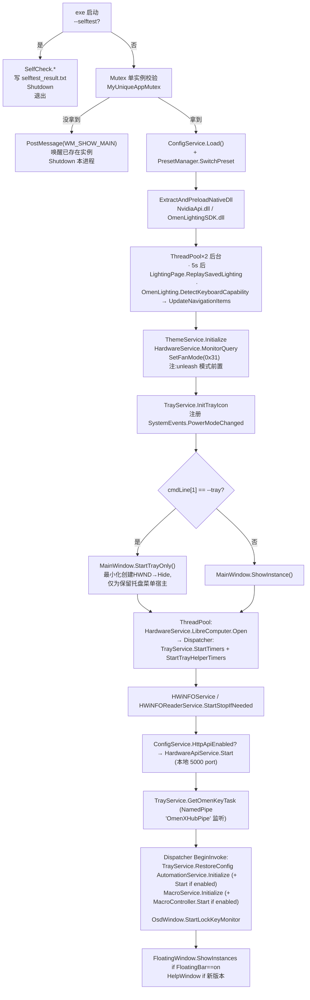

## 2. 运行时主循环 / 定时器矩阵

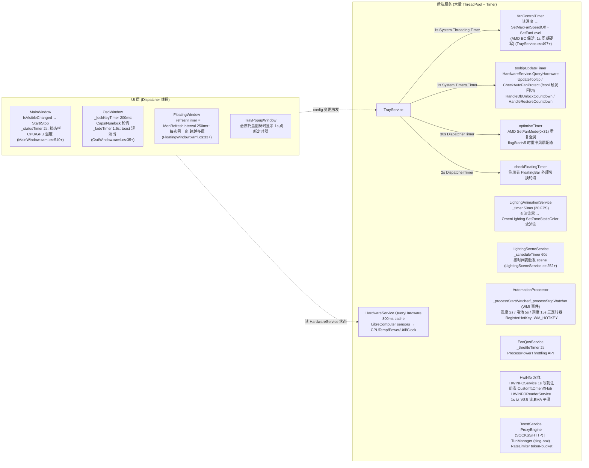

## 3. 硬件控制底座 (Hardware Layer)

硬件访问有**三条并行通道**,不是单一 WMI。选择哪条由 `ConfigService.EnableEcAccess` 与机型决定:

| 通道 | 载体 | 负责什么 | 门控 |
|---|---|---|---|
| **HP BIOS WMI** | `OmenHardware.SendOmenBiosWmi` → `root\wmi` / `hpqBIntM` | 风扇、功率墙请求、GPU 功耗态、传感器温度、灯效、Win/Gaming 键锁 | 无(主通道);`_scopeLock` 串行 + `WmiGateOpen` 健康门/backoff |
| **PawnIO 内核驱动** | `IntelMsr.bin` / `LpcACPIEC.bin` / SMU 寄存器 | Intel RAPL 直写、Intel 预取器、AMD Curve Optimizer、EC 风扇兜底(暗影精灵 6) | 只有 **RAPL** 受 `EnableEcAccess`。预取器按机型能力(有 Intel CPU + `HasPrefetcher`)、AMD 降压按驱动+家族、EC 风扇兜底按 `IsAvailable` —— 三者都不看该开关 |
| **Native SDK / HID** | `OmenLightingSDK.dll`、`McuSDK2.dll`、NVAPI、nvidia-smi | Per-key 灯效、GPU 时钟/功耗偏移、帧率上限 | 见 §4 |

> ⚠ 通道语义差异:**WMI 返回成功 ≠ 寄存器生效**。`SendOmenBiosWmi` 的 `rwReturnCode` 在 0x2E 上装的是风扇 RPM 而非错误码(Omen 6 BIOS quirk)。RAPL 路径正因为这点才补了读-改-写 + 回读验证。

`Services/RaplPowerLimitService.cs` 是 WMI/MSR 双通道共存的样板:`ShouldHandlePowerLimit => ConfigService.EnableEcAccess && IsAvailable`,开启后功率墙**两条通道都发**(MSR 0x610 直写带回读校验,`OmenHardware` 再补发 WMI 0x29),通道不可用则自动只走 WMI,零回归。`EnableEcAccess` 的默认值按机型取:`OmenHardware.IsVictusModel()`(`ConfigService.cs:525`)。

PawnIO 消费方共 5 处:`RaplPowerLimitService` / `XtuService` / `EcFanService` / `AmdUndervoltService` / `Pages/DashboardPage`。非管理员下 PawnIO 读 MSR 返回 `ok=true` + 全零,故相关探针与自检必须提权跑。

**BIOS WMI 命令面(`command` 0x20008 | 0x20009 | 0x2000B)**:

```mermaid
flowchart TD
  subgraph Entry["WMI 入口 (BIOS 通道唯一入口)"]
    SendWmi["OmenHardware.SendOmenBiosWmi\n(cmdType, data, outputSize,\n command = 0x20008 | 0x20009 | 0x2000B)"]
  end

  subgraph WMI["WMI 命名空间 root\wmi"]
    HBI["hpqBIntM (ManagementObject, 缓存为 _biosMethods)"]
    HDI["hpqBDataIn {Command, CommandType, Sign=[SECU], hpqBData, Size}"]
    HBM["hpqBIOSInt{outputSize}  方法返回 OutData{rwReturnCode, Data}"]
    HBI --> HDI --> HBM --> SendWmi
  end

  subgraph Cmd["commandType 真实动作表"]
    C10["0x10 命令\nUnleash 模式前置\nResume 后 EC 唤醒"]
    C1A["0x1A\nSetFanMode(0x31 perf/0x30 default)"]
    C27["0x27\nSetMaxFanSpeedOn/Off\nAMD EC 保活关键"]
    C2E["0x2E\nSetFanLevel(pct1,pct2) 写入目标RPM"]
    C29["0x29\nSetCpuPowerLimit PL1/PL2\nSetConcurrentTdp (TPP)"]
    C37["0x37\nSetCpuPowerLimitPL4 (双字节)\nIccMax, LoadLine"]
    C22["0x22\nSetGpuPowerState CTGP/PPAB/dState\nGetGpuPowerState"]
    C21["0x21\nGetGpuPowerState(读)"]
    C23["0x23\nGetSensorTemperature IR/Amb/PCH/VR"]
    C28["0x28\nGetSystemDesignData(缓存) 机型能力位"]
  end

  subgraph LED["灯效 channel 0x20009 (hpagx BIOS)"]
    L02["0x02 GetZoneStaticColor (BasicFourZone)"]
    L03["0x03 SetLightColor 写色表 (BasicFourZone)"]
    L05["0x05 Backlight on/off, SetBrightness, SetZoneBrightness"]
    L07["0x07 SetZoneAnimation BasicFourZone effectId 限 2/4"]
    L0B["0x0B=11 Dojo 写 SetZoneStaticColor/Animation/Brightness\neffectId 接受 1..9"]
    L0C["0x0C=12 GetCurrentAnimationEffect (Dojo)"]
    L2B["0x2B GetKeyboardType → NbKeyboardLightingType"]
  end

  subgraph Win["command 0x2000B (Win/Gaming 键)"]
    W00["GetWinLock/SetWinLock EC Win/Gaming 键硬件锁"]
  end

  SendWmi --> C10 & C1A & C27 & C2E & C29 & C37 & C22 & C21 & C23 & C28
  SendWmi --> L02 & L03 & L05 & L07 & L0B & L0C & L2B
  SendWmi --> W00
```

## 3b. 传感器源优先级与新鲜度门 (`Services/HardwareService.cs:188-230`)

温度同时有多个来源,靠**优先级守卫 + 3 秒新鲜度**仲裁,不是"最后写入者赢":

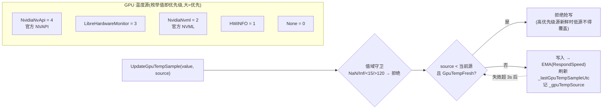

- `GpuTempFresh` / `GpuPowerFresh` = 距上次采样 ≤ **3 秒**(`:193-195`)。高优先级源断供 3 秒后,下一级自动接管。
- `HWiNFOReadEnabled` 时跳过 LHM 传感器轮询;HWiNFO 走同一守卫,前三层新鲜则其写入被拒。
- **消费端只准拿新鲜值**:`TryGetFreshGpuTemp` / `GetEffectiveGpuTemp(fallback)` / `GpuPowerUsable`。风扇、自动化、灯效**必须**经这层 —— 过期数据不得驱动它们。`InvalidateGpuSamples()`(`:224`)在 GPU 目标切换/监控关闭时把时间戳打回 `MinValue` 强制失效。
- GPU 目标按 **Identifier** 解析(`_lastResolvedGpuId`),不按索引。
- CPU 侧同理:LHM 间歇读 null 时**保留上次 EMA 值**而非清空,UI 显示 `-` 而不是抖一下(读不到保留、读到才覆盖)。
- IR 距离传感器:每核一条 `Core #N Distance to TjMax`;1~120°C 钳位,读不到保持负值,风扇 max 忽略该路。

## 4. 灯光控制三路径 (`App/OmenLighting.cs`)

按 `DetectKeyboardCapability()` 探测结果分流:WMI 四区/Dojo · Native SDK per-key · McuSDK2 HID。

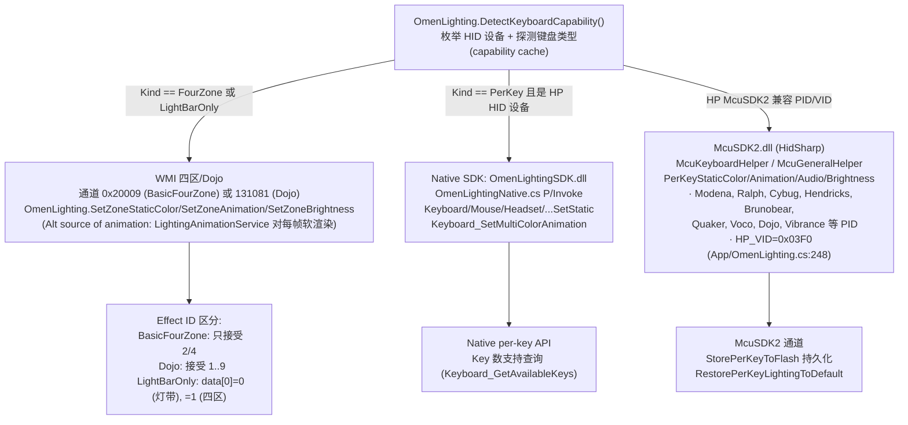

## 5. 预设 / 配置链 (`PresetManager` + `ConfigService`)

```mermaid
flowchart LR
  Trigger["触发点:\n  · 用户托盘菜单 "循环预设" → OmenKey pipe\n  · SettingsPage 用户切换\n  · AutomationProcessor 自动条件触发\n  · Resume 后 OnPowerChange → RestorePowerConfig"]
  Trigger --> Switch["PresetManager.SwitchPreset(preset)\n· 1.1 用 ApplyPresetData 同步 ConfigService 字段\n· 1.2 仅 custom preset 再覆盖\n· 发出 OnPresetChanged (Dispatcher.Invoke)"]

  Switch --> Apply["PresetManager.ApplyPresetHardware()\n单 ThreadPool.QueueUserWorkItem\n原子化硬件写入"]

  Apply --> A1["OmenHardware.SetFanMode(0x31)"]
  Apply --> A2["OmenHardware.SetCpuPowerLimit +\n  SetPL4DoubleByte +\n  AmdUndervoltService.SetAllCoreCO/ApplyPerCoreCO"]
  Apply --> A3["OmenHardware.SetConcurrentTdp (TPP)\n  ⚠ 必须 GPU power 前,否则 PPAB 读旧预算"]
  Apply --> A4["OmenHardware.SetGpuPowerState CTGP/PPAB/dState"]
  Apply --> A5["OmenHardware.SetMaxFanSpeedOff + SetFanLevel\n  FanService.ApplyPresetCurve (custom_<preset>.txt)\n  fanControlTimer.Change"]
  Apply --> A6["GpuAppManager.Set[Core/Memory]ClockOffset\n  NVAPI_SetMaxFrameRate\n  PowerSetActiveScheme + PowerSetActiveOverlayScheme"]
  Apply --> A7["EcoQosService.SetEnabled/SetThrottlePlugged\n  CoreKeepService.StartAutoApply/StopAutoApply"]
  Apply --> A8["TrayService.ApplyRefreshRate (DEVMODE)"]

  Switch -.幂等发火.-> Lss["PresetManager.OnPresetChanged →\nLightingSceneService.NotifyPresetChanged → 可能改场景"]
  Switch -.-> CFC["ConfigService.FirePresetCycled →\nDashboardPage 更新 preset 标\n(关面板时已断订阅 ReleaseFrontend)"]
```

## 6. 跨进程 Omen Key 触发 (E.1)

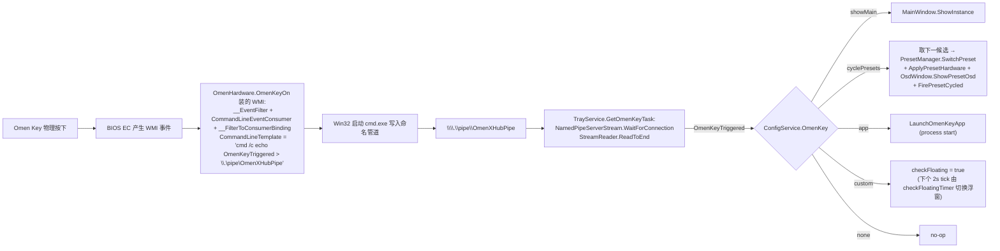

## 7. 关闭主面板的前端释放流程 (F.1-F.3)

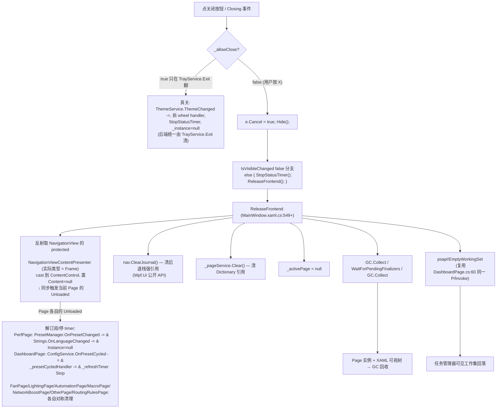

注意:**后端进程链路不动** —— HardwareService / fanControlTimer / tooltipUpdateTimer / AutomationProcessor / MacroController / OmenKey pipe / TrayService timer / SystemEvents.PowerModeChanged 全部按 TrayService/App 持有,不受窗口可见性影响。从最小化唤回(不经过 Hide,只在窗口可见+最小化态点托盘)不会触发本流程,保留热缓存。

## 8. 配置 / 持久化

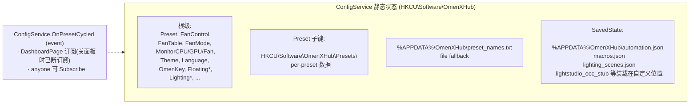

## 9. 进程退出 (`App.OnExit`, App.xaml.cs:285)

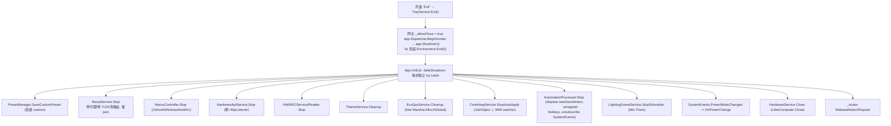

## 10. 自检机制 (`--selftest`, App.xaml.cs:50)

`OmenXHub.exe --selftest` → 不启 UI → 串联 `App.xaml.cs:51-72` 的 **22 段 SelfCheck** → 追加 `[FrontendRelease]` 段(`:76`) → 写 `selftest_result.txt` → `ExitCode = result.Contains("FAIL") ? 1 : 0`。

自检清单按段名归口(每段一个 `SelfCheck()`,与被测代码同文件):

| 段 | 来源 | 断言什么 |
|---|---|---|
| `[CpuAffinity]` | `CpuAffinity/CoreKeepService.cs:940` | 拓扑/掩码/模式归一;含免提权反射探针 `artifacts/ck_selftest_probe.cs` |
| `[OmenHardware]` | `OmenHardware.cs:1219` | WMI 载荷编码、机型识别 |
| `[RaplPowerLimit]` | `RaplPowerLimitService.cs:299` | 0x610 读-改-写位域 + boot 身份快照解析(崩溃自愈) |
| `[Xtu]` | `XtuService.cs:144` | 预取器 MSR 0x1A4 位编码(out-param 形态) |
| `[FanService]` | `FanService.cs:45` | 曲线插值、EMA、share-code 往返(`ParseShareCode(GenerateShareCode(...))`) |
| `[HardwareService]` | `HardwareService.cs:558` | 传感器缓存/降级 |
| `[TrayService]` | `TrayService.cs:1229` | 动态图标 `ApplyIconStyle` 哨兵复位、自启任务幂等 |
| `[Boost]`/`[SystemProxy]`/`[RateLimiter]` | `NetworkBoost/*` | 端口池步进不串流、用户代理快照-还原、小速率死锁 |
| `[TunManager]` | `TunManager.cs:208` | **`JobKillOnCloseSelfCheck`** 真起进程验 `AssignProcessToJobObject`;`ShutdownFlagSelfCheck` 退出清 TUN 路由 |
| `[AutomationProcessor]`/`[MacroController]`/`[MacroService]` | 各自文件 | 触发器/步骤匹配、钩子对称卸载、JSON 往返 |
| `[LightingScene]`/`[LightAnim]`/`[LightBarAnims]`/`[LayoutState]` | 灯效四处 | effectId 白名单(四区 2/4、Dojo 1..9)、帧渲染 |
| `[DiskCleaner]` | `DiskCleaner.cs:232` | 清理项分类与占用跳过 |
| `[GpuPref]` | `DashboardPage.cs:1686` | GPU 首选项 `REG_SZ GpuPreference=N` 映射(原 DWORD+错映射恒无效) |
| `[DisplayConfig]` | `Pages/NativeMethods.cs:86` | DISPLAYCONFIG 结构体尺寸(Release 常开尺寸闸) |
| `[ThreadBinding]` | `ThreadBindingService.cs:193` | 跨组绑定/解绑恢复满掩码 |
| `[FrontendRelease]` | `App.xaml.cs:455` | 反射驱动: `CachedPageService._cache` 清空、`PerfPage.Instance` 置 null、`OnPresetCycled` 无 DashboardPage 残留订阅 |


## 11. 网络加速 (sing-box / TUN) (`Services/NetworkBoost/`)

两种互斥模式,`BoostService` 编排,`RoutingRulesPage` + `NetworkBoostPage` 是前端:

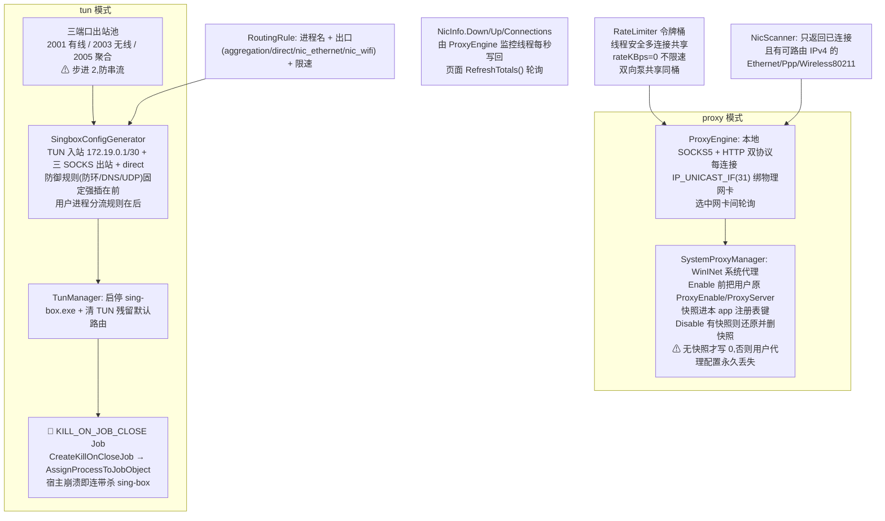

**sing-box 生命周期两个硬约束**(踩过,勿改回):
1. 子进程必须在 `KILL_ON_JOB_CLOSE` Job 里 —— 孤儿 sing-box 会黑洞全系统网络。`TunManager.cs:96/165/241` 三处,且有自检真起进程验证。
2. `sing-box.exe` 无 Authenticode 签名,**不能**走 `ExtractAndPreloadNativeDll`(验签失败会删文件);单独提取到 `bin\`,`wintun.dll` 同目录。`TunManager.BinDir`。

UI 活性回查用 `TunManager.IsRunning`,不信配置字段。

## 12. 绑核 / CoreKeep (`Services/CpuAffinity/`)

旧 `CoreKeep.json` 兼容层 + 新三层架构(参考 CpuAffinityManager 移植):

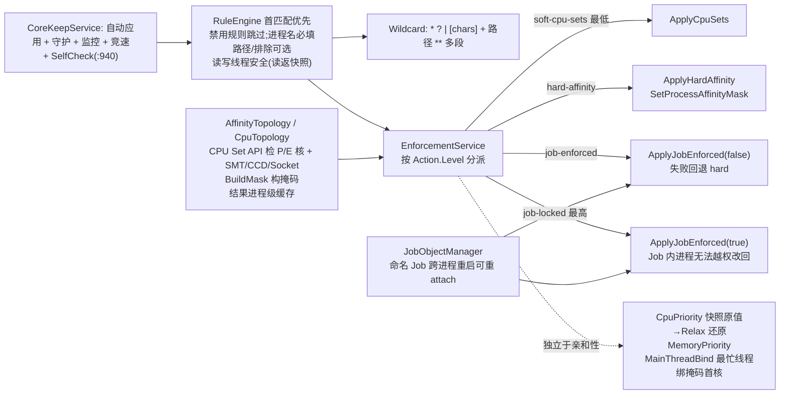

**已修的两个静默失败**(改这块前必读):
- `SetThreadGroupAffinity` 需要 `THREAD_SET_INFORMATION` (0x0020),不是 `THREAD_SUSPEND_RESUME`;MSDN 误导。原句柄缺此权限时**一直静默失败**。
- 解绑必须恢复**组内满掩码** + 进程默认逐组数组;跨组取众数掩码并记日志。CPU set ID ≠ 处理器编号(`SetThreadSelectedCpuSets` 否则 gle=813)。
- `CpuTopologyService` 原生结构体偏移曾全错致假拓扑;效率等级方向已归一;>32 逻辑处理器拒绝用掩码。

`HeteroCpuService` 是 AMD 异构的并行实现(注册表 `SmallProcessorMask` 需重启 / `SetThreadGroupAffinity` 即时),与 `ThreadBindingService` 的实时绑定路径不同,别混。

## 13. Intel / AMD 硬件调校现状(范围已收缩)

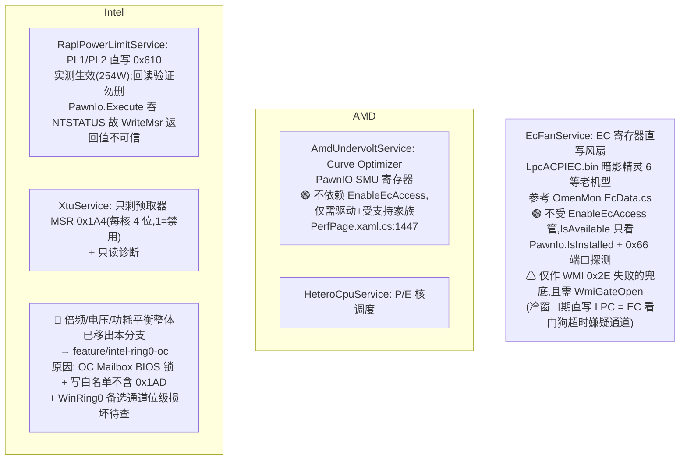

旧文档若还声称 Intel 超频在主干可用 —— 不可用。`Models/PerfPreset.cs` 已删,`Pages/CpuOcDialog.xaml` 已删。

## 14. 系统优化 / 清理 / 杂项能力

| 能力 | 实现 | 可逆性要点 |
|---|---|---|
| 启动项管理 | `SystemOptimization/StartupItemOptimizer` | **禁用即物理搬迁** `Run`/`RunOnce` → `RunDisabled`/`RunOnceDisabled`,Startup 文件夹 → `Startup\Disabled`;再枚举时 `is_disabled=true`,UI 与实际一致 |
| 服务优化 | `SystemOptimization/SystemServiceOptimizer` | SCM 枚举 → 改启动类型 + **失败回滚** |
| 通用 tweaks | `SystemOptimization/SystemTweaks` | 注册表级,每项独立可逆(写优化值 / 写回默认或删除该项);支持 HKLM/HKCU × 32/64 视图 |
| 储存清理 | `DiskCleaner` + `StorageCleanWindow` | Dism++ 分类模型:扫描→勾选→清理→复扫;逐文件跳过占用;单例 |
| 出厂重置 | `CleanupService` | 清注册表/计划任务/配置/数据目录;对齐 `clean_oxh.bat` 但**跳过对自身进程的 taskkill** |
| 电池健康 | `BatteryHealthService` | `Win32_Battery` 磨损度 =(1−Full/Design)×100;查询失败返回不在场不抛异常;⚠ CycleCount 读不到(需 IOCTL,本轮不做);上限见 `docs/BATTERY_CHARGE_LIMIT_FINDINGS.md` |
| Win 键锁 | `WinKeyLockService` | 优先 HP WMI `0x2000B` 硬件锁(EC 层),失败回退 `WH_KEYBOARD_LL` |
| 触摸板锁 | `TouchpadLockService` | SetupAPI 禁/启 HID 精确触摸板,通用即时;**HP 无等价 WMI** |
| 灯效温度联动 | `LightingTemperatureService` | 4s 轮询(WMI 单写 ~200ms,防堆积);手动或 `TriggerMode="Temperature"` |
| 音频律动 | `AudioCaptureService` | NAudio `WasapiLoopbackCapture` 抓系统输出 → 帧 RMS + EMA;无设备优雅降级(能量=0);仅 AudioPulse 激活时起,不常驻 |
| 实时网速 | `NetworkSpeedService` | `GetIPv4Statistics()`,与任务管理器同源 |
| FPS | `PresentMonFpsMonitor` | 1.5s 采样窗;启动失败 10s 重试;浮窗用 |
| OGH 存根 | `OccStubService` | Light Studio 查 `AD2F1837.OMENCommandCenter` 包;维护同名空壳包注册 → 需**开发者模式**(`Add-AppxPackage -Register` 免签名);PowerShell 壳,低频可接受 |
| 多语言 | `App/Strings.cs` | 简/繁/英三语 `T(zh, zhHant, en)`,`OnLanguageChanged` 事件;各页 Unloaded 对称退订 |
| 日志 | `App/Logger.cs` | `OmenXHub.log`,Info/Warn/Error/Verbose,30s 去重节流 |
| 托盘 | `Utils/NativeTrayIcon` + `Utils/TrayHelper` | ⚠ **可见菜单在 `TrayHelper.BuildContextMenu`**;`wpfContextMenu` 只是逻辑菜单从不显示,加菜单项要改对地方 |
| 弹窗规范 | `Utils/DialogHelper` + `Utils/WindowHelper` | FluentWindow+Mica 替代 MessageBox;`DetachOwnerOnClose` 统一断 Owner,否则关 owned window 会误最小化主窗(模态跳过) |

## 15. 文档地图 (docs/ 才是 ground truth 出处)

本文件只画数据流与 call graph。**硬件语义的正确性判据在 `docs/`,改硬件代码前先看对应篇**:

| 主题 | 文档 |
|---|---|
| 官方 vs 本项目能力对照/路线 | `docs/CAPABILITY_MAP.md`(✅已验证 🟡路径不同 ⚠可能有错 🔵未实现 ⬜非目标) |
| 风扇 | `OMEN_OFFICIAL_FAN_ALGORITHM.md`(官方仅两路输出、三路温度取 max;EWMA 仅 CPU)、`OMEN_3FAN_DUST_REMOVAL.md`、`FAN_CONTROL_PIPELINE.md` |
| Intel 电压/倍频 | `INTEL_VOLTAGE_ENCODING_GROUND_TRUTH.md`、`MEMORY_XTU_HSA_RE.md` |
| AMD 降压 | `OMEN_OFFICIAL_AMD_UNDERVOLT_PATH.md`、`OMEN_OFFICIAL_AMD_CO_STATE_MACHINE.md` |
| 传感器公式 | `OMEN_OFFICIAL_SENSOR_FORMULAS.md` |
| 功耗/热/内存诊断 | `MEMORY_POWER_THERMAL_DIAGNOSTICS.md`(WMI 成功≠生效的出处) |
| 灯效/浮窗逆向 | `lighting-reverse-findings.md`、`OMEN_OVERLAY_RE.md` |
| 电池充电上限 | `BATTERY_CHARGE_LIMIT_FINDINGS.md` |
| 构建 | `BUILD_GUIDE.md`、`OXH_OPTIMIZATION_GUIDE.md` |
| 托盘图标排障 | `DIAGNOSE_TRAY_ICON.md`、`TRAY_ICON_FIX.md`、`TEST_DYNAMIC_ICON.md` |

根目录另有一批历史报告类 md(`PROJECT_SUMMARY.md`/`FRONTEND_REVIEW.md`/`COMPILE_*.md`/`BUILD_REPORT.md`/`ReviewFindings-Remaining.md`/`LOGGER_FIX_COMPLETE.md`/`QUICK_VERIFICATION.md`),多为一次性记录,不作权威来源。

## 附录 — 文件 → 责任对照

| 文件 | 责任概要 |
|---|---|
| `App.xaml.cs` | 启动入口、Mutex 单实例、`--selftest`、OnExit 顺序清场 |
| `OmenHardware.cs` | HP BIOS WMI 通道 (`hpqBIntM`) + 灯效 WMI 相关 + GPU/系统检测 |
| `App/OmenLighting.cs` | 灯效双路径(WMI / Native SDK / McuSDK2 HID)+ 键盘能力探测 |
| `Services/OmenLightingNative.cs` | OmenLightingSDK.dll P/Invoke wrap |
| `Services/HardwareService.cs` | LibreHardwareMonitor 传感器 + 800ms 缓存 + GPU AC 检测 |
| `Services/TrayService.cs` | 托盘图标 + 多个 timer 进 + WMI hook + OmenKey pipe + Exit() 清场 |
| `Services/PresetManager.cs` | 内置/自定义预设 + SwitchPreset/ApplyPresetHardware 原子硬件写入 |
| `Services/FanService.cs` | 风扇曲线引擎 (smart EMA + hysteresis + 文件持久化) |
| `Services/AutomationProcessor.cs` | 事件驱动自动化管道 + 3 timer + WM_HOTKEY + WMI watcher |
| `Services/AutomationService.cs` | AutomationPipeline 数据模型 + JSON |
| `Services/MacroController.cs` | WH_KEYBOARD_LL/WH_MOUSE_LL 全局钩子 + 录制回放 |
| `Services/MacroService.cs` | MacroSequence 数据模型 + JSON + trigger-key index |
| `Services/LightingSceneService.cs` | 灯光场景 CRUD + 60s 调度 + 预设联动 |
| `Services/LightingAnimationService.cs` | 4 区软件渲染帧引擎 (20 FPS) |
| `Services/ThemeService.cs` | Dark/Light 系统 + Mica + DWM 口味 |
| `Services/EcoQosService.cs` | ProcessPowerThrottling (后台进程节流) |
| `Services/BoostService.cs` + NetworkBoost/ | 多 NIC 代理 + tun (sing-box.exe) + 速率限制 |
| `Services/HardwareApiService.cs` | 本地 HTTP API (port 5000, X-Auth-Token Guid) |
| `Services/HWiNFOService.cs`/`HWiNFOReaderService.cs` | HWiNFO64 双向 (写自定义传感器 / 读 VSB) |
| `Services/AmdUndervoltService.cs` | AMD Ryzen Curve Optimizer (PawnIO SMU);不依赖 EnableEcAccess |
| `Services/RaplPowerLimitService.cs` | Intel RAPL PL1/PL2 直写 MSR 0x610(读-改-写+回读);boot 身份崩溃自愈快照 |
| `Services/XtuService.cs` | ⚠ 仅剩 Intel 预取器 MSR 0x1A4 读写 + 只读诊断;超频面已移 `feature/intel-ring0-oc` |
| `Services/EcFanService.cs` | EC 寄存器直写风扇(LpcACPIEC.bin,暗影精灵 6 适配,参考 OmenMon) |
| `Services/CpuTopologyService.cs` | `GetLogicalProcessorInformationEx`+`GetSystemCpuSetInformation` 拓扑(CCD/CCX/效率等级/缓存组);多组保留+按(组,核)去重 SMT |
| `Services/HeteroCpuService.cs` | AMD 异构调度:注册表 `SmallProcessorMask`(需重启) / 实时 `SetThreadGroupAffinity` |
| `Services/ThreadBindingService.cs` | 实时线程/进程绑核:`SetThreadGroupAffinity`(组内掩码)+`SetProcessDefaultCpuSetMasks` |
| `Services/CpuAffinity/*` | CoreKeep 三层:`RuleEngine`(首匹配)→`EnforcementService`(4 级 soft-cpu-sets/hard/job-enforced/job-locked)→`JobObjectManager`(命名 Job 跨重启 attach);`AffinityTopology`/`CpuTopology` 掩码;`Wildcard` 匹配;`Native` 全 P/Invoke;`CoreKeepService` 自动应用+守护+竞速+SelfCheck |
| `Services/NetworkBoost/*` | `BoostService` proxy/tun 编排 · `ProxyEngine` SOCKS5+HTTP 绑网卡 · `TunManager` sing-box+TUN 路由+**KILL_ON_JOB_CLOSE Job** · `SingboxConfigGenerator` 配置生成 · `RateLimiter` 令牌桶 · `SystemProxyManager` WinINet 快照-还原 · `NicScanner`/`NicInfo` · `RoutingRule` 进程分流 |
| `Services/SystemOptimization/*` | `StartupItemOptimizer`(禁用即物理搬迁) · `SystemServiceOptimizer`(SCM+失败回滚) · `SystemTweaks`(注册表逐项可逆) |
| `Services/DiskCleaner.cs` + `Views/StorageCleanWindow` | 储存清理(Dism++ 分类模型:扫描→勾选→清理→复扫) |
| `Services/CleanupService.cs` | 出厂重置(注册表/计划任务/配置/数据目录) |
| `Services/BatteryHealthService.cs` | 电池磨损度(Win32_Battery;CycleCount 读不到) |
| `Services/WinKeyLockService.cs` | Win 键锁:HP WMI 0x2000B 优先 → `WH_KEYBOARD_LL` 回退 |
| `Services/TouchpadLockService.cs` | SetupAPI 禁/启 HID 精确触摸板(HP 无等价 WMI) |
| `Services/LightingTemperatureService.cs` | 温度联动灯效(4s 轮询,WMI 单写 ~200ms) |
| `Services/AudioCaptureService.cs` | NAudio WASAPI loopback → 音乐律动能量(按需起停) |
| `Services/NetworkSpeedService.cs` | 实时网速(`GetIPv4Statistics`,与任务管理器同源) |
| `Services/PresentMonFpsMonitor.cs` | PresentMon FPS(1.5s 采样窗,浮窗用) |
| `Services/OccStubService.cs` | OGH `AD2F1837.OMENCommandCenter` 空壳包存根(需开发者模式) |
| `Services/NativeDefs.cs` | 共享电源 overlay GUID(⚠ 函数/结构体已归口 `Pages/NativeMethods.cs`) |
| `Pages/NativeMethods.cs` | Display/Power/Proc P/Invoke 唯一归口 + `[DisplayConfig]` 尺寸自检 |
| `App/Logger.cs` | `OmenXHub.log`,Info/Warn/Error/Verbose,30s 去重节流 |
| `App/Strings.cs` | 简/繁/英三语 `T(zh, zhHant, en)` + `OnLanguageChanged` |
| `App/GpuAppManager.cs` | nvidia-smi + NvAPIWrapper:GPU 应用列表/时钟偏移/功耗限制/超频/帧率上限 |
| `Utils/TrayHelper.cs` | ⚠ **托盘可见菜单在 `BuildContextMenu`**;`wpfContextMenu` 只是逻辑菜单从不显示 |
| `Utils/NativeTrayIcon.cs` | `Shell_NotifyIconW` 原生托盘 + 光标轮询合成 MouseEnter/Leave |
| `Utils/WindowHelper.cs` | `DetachOwnerOnClose` — 关 owned window 前断 Owner(模态跳过),防误最小化主窗 |
| `Utils/DialogHelper.cs` | FluentWindow+Mica 弹窗,替代 MessageBox |
| `Utils/ProgressBarAnimation.cs` | 进度条动画辅助 |
| `Controls/FanIcon.cs` | 矢量风扇 `IconElement`(4 叶 90° 对称 GeometryGroup + RotateTransform) |
| `Models/LightingScene.cs` | 灯光场景模型(参考 OmenCore RgbScene;多场景+预设联动+时间调度) |
| `Views/MainWindow.xaml.cs` | 导航 + 关面板释放 (ReleaseFrontend) + 托盘唤起 WndProc hook |
| `Services/CachedPageService.cs` | Wpf.Ui IPageService + Clear() for ReleaseFrontend |
| `Windows/BaseWindow.cs` | Mica + DPI FluentWindow 基类 |
| `Views/FloatingWindow.xaml.cs` | 多屏浮窗 + PresentMon FPS + 单计时器 |
| `Views/OsdWindow.xaml.cs` | Caps/NumLock 轮询 + preset OSD toast |
| `Views/HelpWindow.xaml.cs` | 关于窗 (singleton) |
| `Views/TrayPopupWindow.xaml.cs` | 托盘悬停弹窗 (1s 刷新) |
| `Views/PipelineEditorWindow.xaml.cs` | 自动化流水线编辑器(卡片式,展开/折叠/拖拽排序) |
| `Views/ProcessSelectDialog.xaml.cs` | 进程选择器(复用 `CoreKeepService.EnumerateProcesses`) |
| `Views/SystemOptimizeWindow.xaml.cs` | 系统优化弹窗(服务/启动项/tweaks 三合一,单例) |
| `Views/StorageCleanWindow.xaml.cs` | 储存清理弹窗(单例) |
| `Pages/*` | Dashboard / Fan / Perf / Lighting / Automation / Macro / NetworkBoost / CoreKeep / RoutingRules / Other / Settings + 各页 Loaded/Unloaded 对称清理 |

## 附录 B — 构建 / 目录陷阱

- `LibreHardwareMonitor-pawnio-squashed/` 是 vendored,**永不编辑、永不进 glob/review**。
- `Resources/` 是厂商 SDK DLL 黑盒(HP.Omen.*、McuSDK2、IntelXTUSDK、NvidiaApi、OmenLightingSDK、PawnIO_setup.exe…)。
- `OverlayDemo/` 独立演示工程,csproj 里必须 **Page + Compile 双排除**。
- 两套输出目录并存(`bin/x64/Release/net481`、`binReleasenet481-verify/`),别混用;陈旧构建是"应用内写入损坏"的头号嫌疑。
- `artifacts/`、`tools/battprobe/`、`tools/ownerfix-verify/` 是一次性探针(反射调 SelfCheck 免 UAC 的 `ck_selftest_probe.cs` 在 `artifacts/`),不属于产品代码。
- `hooks/` 是 ponytail agent 钩子,`pi-extension/` 是编辑器扩展 —— 与 app 无关。
- `nul` 文件是历史误建,已在打包 Excludes 里。
- 根级 `*_FIX_COMPLETE.md` / `COMPILE_*.md` / `BUILD_REPORT.md` 属一次性历史报告,别当权威;权威在 `docs/`。
